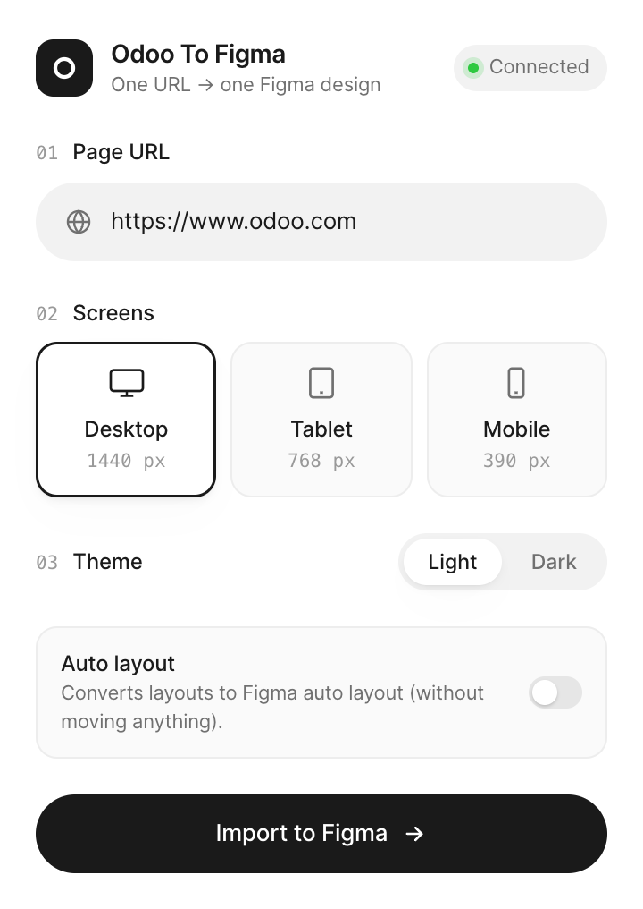

<div align="center">

<picture>
  <source media="(prefers-color-scheme: dark)" srcset="docs/logo-dark.svg">
  
</picture>

# Odoo To Figma

**Paste a link. Get an editable Figma design.**

Any web page (an Odoo website, the Odoo back office, any other site) rebuilt in Figma as real layers: text, images, icons, auto layout.


<br>

<picture>
  <source media="(prefers-color-scheme: dark)" srcset="docs/plugin-dark.png">
  
</picture>

</div>

<br>

## Install

> [!IMPORTANT]
> You need a **Mac**. Everything else is installed for you.

**1. Open the Terminal app.** Press <kbd>⌘</kbd> <kbd>Space</kbd>, type `Terminal`, press <kbd>Return</kbd>.

**2. Copy this line, paste it in the Terminal, press <kbd>Return</kbd>.**

```bash
curl -fsSL https://raw.githubusercontent.com/tocodoo/odoo-to-figma/main/install.sh | bash
```

It takes a few minutes. When it is done, you will see **Last step, in Figma Desktop**.

> [!TIP]
> If a window asks to install the **Command Line Tools**, click **Install**. The Terminal waits for it, then continues on its own.

**3. Add the plugin to Figma.** In Figma Desktop, open the menu **Plugins → Development → Import plugin from manifest…**. In the window that opens, press <kbd>⌘</kbd> <kbd>⇧</kbd> <kbd>G</kbd>, paste the path below, press <kbd>Return</kbd>, then click **Open**.

```
~/odootofigma/figma-plugin/manifest.json
```

That's it, you only do this once.

## Use

1. In Figma: **Plugins → Development → Odoo To Figma**.
2. Click **Start server** (once per session).
3. Paste a link, pick the screens, click **Import to Figma**.

Each screen lands next to what is already on your page, ready to edit.

**Page behind a login** (e.g. `…/odoo/rooms`): turn on **Login required**. It logs in on the site's `/web/login` with `admin` / `admin`, unless you enter another login page or credentials.

**Only a modal, a tab, a menu…**: turn on **Click before export** and type the button texts to click, in order, separated by `>` (e.g. `New > Send by email`). Then pick what to export: **Page**, **Screen** (what fits on screen, with the page behind the modal), **Modal** (the modal alone) or **Element** (a CSS selector).

## Updates

Nothing to do. When a new version is out, the plugin shows **Update required**: click **Update now**, then reopen the plugin.

## Use it with Claude

> [!NOTE]
> Optional. Only if you use [Claude Code](https://claude.com/claude-code).

The install connects Claude to the plugin. Restart Claude Code, keep the plugin open in Figma, and ask in plain words:

- *Open https://demo.odoo.com/odoo/sales, click New, then export the screen to Figma.*
- *On this page, click "Send by email" and export only the modal.*
- *Export every view of this app, in desktop and mobile.*

For a page behind a login, Claude opens a Chrome window where you log in yourself.

## Something wrong?

| Problem | What to do |
|---|---|
| The plugin stays on **Server stopped** | Paste the install line again in the Terminal, then click **Start server**. |
| The update fails | Paste the install line again in the Terminal. |
| A font looks different | The plugin names the missing font at the end of the import: install it on your Mac and import again. |
| Anything else | [Open an issue](https://github.com/tocodoo/odoo-to-figma/issues) and attach `~/Library/Logs/Odoo To Figma/launcher.log`. |

<br>

<details>
<summary><b>What gets rebuilt in Figma</b></summary>

<br>

- **Layout**: exact positions and sizes, layers named after the page structure, stacking order, clipped content.
- **Text**: real fonts, weights, sizes, spacing and links. A paragraph stays one layer, with the browser's line breaks.
- **Images**: the original files, never redrawn, with their crop and rounded corners. WebP and AVIF are converted to PNG.
- **Icons**: real vectors, named and recolorable, from any icon font (Font Awesome, Material Symbols, Odoo icons, Bootstrap Icons…) or inline SVG.
- **Styles**: colors, gradients, borders, rounded corners, shadows, blur, blend modes, opacity, rotations, `clip-path` masks.
- **Tables**: rebuilt column by column, like you would by hand.
- **Charts**: Chart.js charts as editable vectors.
- **Auto layout** (optional): direction, padding, gaps, alignment and sizing inferred from the page, without moving anything.
- **Odoo**: scroll animations, lazy images, sticky headers and back-office screens are handled.

</details>

<details>
<summary><b>What the install does</b></summary>

<br>

[`install.sh`](install.sh) checks each prerequisite and installs what is missing, from the official sources:

| | Installed if missing |
|---|---|
| **Git** | Apple's Command Line Tools |
| **Node.js** 18+ | nodejs.org, checksum verified, in `~/Library/Application Support/Odoo To Figma/node` |
| **Google Chrome** | google.com, in `/Applications` (or `~/Applications` without admin rights) |
| **Figma Desktop** | figma.com, same place |

Then it clones this repository into `~/odootofigma` (the plugin updates itself through git), installs the dependencies, a small launcher that starts with your session (it starts the render server when you click **Start server**, and applies updates), and the MCP server for Claude Code. Running it again updates everything.

Change the clone folder with `ODOO_TO_FIGMA_DIR`. Avoid `~/Documents`, `~/Desktop` and `~/Downloads`: macOS keeps background services out of them, which blocks updates.

To uninstall: run `npm run uninstall-launcher` in `~/odootofigma`, delete the folder, and remove the plugin in Figma.

</details>

<details>
<summary><b>Claude tools and export scopes</b></summary>

<br>

Claude drives its own Chrome window: it reads the page (links, buttons, tabs, menus, open dialogs, with a screenshot), clicks, types, then exports.

| Scope | What is exported |
|---|---|
| Full page | the whole page (default) |
| Visible screen | what is on screen, e.g. a modal with the backdrop behind it |
| One element | only a modal, a menu, a card, a chart or a table |

Each export becomes a named frame in Figma. If the plugin is closed, exports wait and are imported as soon as it opens. Login cookies are kept in `~/Library/Application Support/Odoo To Figma/profile`.

Tools: `open_page`, `get_page`, `click`, `hover`, `type_text`, `press_key`, `go_back`, `scroll`, `export_to_figma`, `import_url_to_figma`, `import_html_to_figma`, `figma_status`, `close_browser`.

For Claude Desktop, the install prints the line to add to `claude_desktop_config.json`.

</details>

<details>
<summary><b>For developers</b></summary>

<br>

```
install.sh           One-command install and update
figma-plugin/        The Figma plugin (manifest, main code, UI)
server/
  index.js           HTTP render server (port 3999)
  launcher.js        Starts/stops the server and applies updates (port 3998)
  mcp.js             MCP server (stdio) used by Claude
  session.js         Chrome session driven by Claude
  jobs.js            Export queue to the plugin (Server-Sent Events)
  capture.js         Page loading, scrolling, images, screenshots
  snapshot-to-ir.js  Chrome layout → layer tree
  autolayout.js      Auto layout inference
  css.js             Colors, gradients, shadows, sizes
  fa4.js             Font Awesome 4.7 icons as vectors
  iconfonts.js       Any icon font as vectors (fontkit)
  page-scripts.js    Scripts run inside the page
scripts/             Launcher install, test tools
test/                Fake Figma to test the plugin without Figma
```

```bash
npm start                                                  # start the server by hand
npm run capture -- https://www.odoo.com desktop out.json   # command-line capture
npm run test:plugin -- out.json [--auto-layout]            # run the plugin in a strict fake Figma
node test/check-autolayout.js out.json                     # check that auto layout moves no layer
npm run test:mcp                                           # full Claude scenario with a fake plugin
node scripts/preview.js out.json out --original            # control render + original screenshot
python3 scripts/compare.py out 0 900                       # side-by-side comparison
```

| Variable | Default | Purpose |
|---|---|---|
| `PORT` | `3999` | Server port |
| `LAUNCHER_PORT` | `3998` | Launcher port |
| `HOST` | `127.0.0.1` | Listening interface |
| `CHROME_PATH` | auto | Chrome path if not detected |
| `ODOO_TO_FIGMA_DIR` | `~/odootofigma` | Where `install.sh` clones the repository |
| `ODOO_TO_FIGMA_REPO` | this repository | Repository `install.sh` clones |

To use a hosted server, enter its address in **Server settings** at the bottom of the plugin, and add its domain to `networkAccess.allowedDomains` in `figma-plugin/manifest.json`.

</details>
